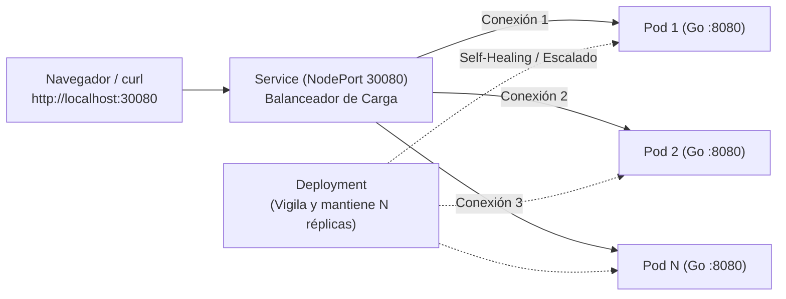

# Documentación Técnica: `Dockerfile` y `k8s-manifest.yaml`

Este documento explica qué son y qué hace cada línea de los archivos de infraestructura del proyecto (`Dockerfile` y `k8s-manifest.yaml`) para la demostración de **Sistemas Distribuidos con Docker y Kubernetes**.

---

## 1. ¿Qué es el `Dockerfile` y qué se establece en él?

### ¿Qué es?
Un **`Dockerfile`** es una "receta" de texto que contiene las instrucciones paso a paso para empaquetar nuestra aplicación en una **imagen de contenedor** (`app-distribuidos:v1`). Gracias a esto, el programa corre exactamente igual en cualquier computadora o nodo del clúster sin necesitar tener Go instalado en el servidor final.

En este proyecto usamos una técnica llamada **Multi-Stage Build (Construcción en múltiples etapas)**:
1. **Etapa 1 (`builder`)**: Usa una imagen pesada con el compilador de Go instalado solo para transformar el código fuente `main.go` en un archivo ejecutable binario (`app`).
2. **Etapa 2 (Imagen final)**: Usa una imagen de Linux ultracompacta (`alpine`, que pesa apenas ~7 MB) y copia **únicamente el ejecutable compilado**, descartando todo el compilador de Go para que los contenedores levanten rapidísimo.

### Explicación línea por línea de nuestro `Dockerfile`

```dockerfile
# --- ETAPA 1: COMPILACIÓN (Builder) ---
FROM golang:1.22-alpine AS builder
WORKDIR /app
COPY main.go .
RUN CGO_ENABLED=0 GOOS=linux go build -o app main.go

# --- ETAPA 2: IMAGEN FINAL LIGERA ---
FROM alpine:latest
WORKDIR /root/
COPY --from=builder /app/app .
EXPOSE 8080
CMD ["./app"]
```

- **`FROM golang:1.22-alpine AS builder`**: Descarga una imagen base oficial con Go 1.22 y la nombra temporalmente `builder`.
- **`WORKDIR /app`**: Define `/app` como la carpeta de trabajo dentro del contenedor compilador.
- **`COPY main.go .`**: Copia nuestro archivo `main.go` desde nuestra PC hacia adentro del contenedor.
- **`RUN CGO_ENABLED=0 GOOS=linux go build -o app main.go`**:
  - Compila el código Go generando un binario llamado `app`.
  - `GOOS=linux`: Asegura que el ejecutable sea para Linux (donde corren los contenedores de Kubernetes).
  - `CGO_ENABLED=0`: Genera un binario estático (sin dependencias de librerías de C externas), para que pueda correr en un sistema mínimo como Alpine.
- **`FROM alpine:latest`**: Inicia una nueva imagen limpia y liviana desde cero basada en Alpine Linux.
- **`WORKDIR /root/`**: Se posiciona en la carpeta `/root/` de esta nueva imagen.
- **`COPY --from=builder /app/app .`**: Trae el archivo ejecutable `app` que se creó en la Etapa 1 (`builder`) y descarta todo lo demás.
- **`EXPOSE 8080`**: Documenta que el contenedor escucha peticiones en el puerto TCP `8080`.
- **`CMD ["./app"]`**: Indica el comando que debe ejecutarse automáticamente apenas arranca el contenedor (iniciar nuestro servidor web en Go).

---

## 2. ¿Qué es el `k8s-manifest.yaml` y qué se establece en él?

### ¿Qué es?
Un **manifiesto de Kubernetes (`k8s-manifest.yaml`)** es un archivo de configuración **declarativo**. En lugar de darle órdenes manuales a Kubernetes de cómo levantar cada contenedor, en este archivo declaramos el **"estado deseado"** del sistema (cuántas réplicas queremos, qué imagen usar, cómo exponerlo a la red y qué permisos tiene). Kubernetes se encarga continuamente de que la realidad coincida con este archivo.

En nuestro archivo `k8s-manifest.yaml` se definen **4 objetos** separados por `---`:

1. **`Role` (Permisos)**: Define qué acciones están permitidas dentro del clúster.
2. **`RoleBinding` (Asignación de permisos)**: Le otorga ese `Role` a nuestros Pods para que los botones de la página web puedan escalar y apagar nodos.
3. **`Deployment` (Gestión de Pods y Réplicas)**: Define nuestra aplicación, cuántas copias (Pods) deben estar vivas y cómo reemplazarlas si fallan (*Self-Healing*).
4. **`Service` (Balanceador de Carga y Red)**: Crea un punto de entrada único (`localhost:30080`) que reparte el tráfico entre todos los Pods activos.

---

### Explicación sección por sección de nuestro `k8s-manifest.yaml`

#### A. `Role` y `RoleBinding` (Control de Acceso - RBAC)
Por defecto, por seguridad, un contenedor dentro de Kubernetes no tiene permiso para controlar al propio clúster. Como nuestra interfaz web tiene botones para **escalar réplicas** y **apagar nodos**, estas dos secciones le dan permiso a la cuenta interna (`ServiceAccount: default`) para hablar con la API de Kubernetes:

```yaml
apiVersion: rbac.authorization.k8s.io/v1
kind: Role
metadata:
  name: app-distribuidos-role
rules:
- apiGroups: [""]
  resources: ["pods"]
  verbs: ["get", "list", "delete"] # Permite ver la lista de pods y eliminarlos (botón "Apagar Nodo")
- apiGroups: ["apps"]
  resources: ["deployments", "deployments/scale"]
  verbs: ["get", "patch", "update"] # Permite leer y modificar la cantidad de réplicas (botones "+1 / -1 Nodo")
---
apiVersion: rbac.authorization.k8s.io/v1
kind: RoleBinding
metadata:
  name: app-distribuidos-rb
subjects:
- kind: ServiceAccount
  name: default
  namespace: default
roleRef:
  kind: Role
  name: app-distribuidos-role
  apiGroup: rbac.authorization.k8s.io
```

---

#### B. `Deployment` (Despliegue, Escalabilidad y Auto-recuperación)
El `Deployment` es el controlador que vigila que siempre haya `N` instancias (Pods) de nuestra aplicación corriendo:

```yaml
apiVersion: apps/v1
kind: Deployment
metadata:
  name: app-distribuidos
  labels:
    app: app-distribuidos
spec:
  replicas: 2
  selector:
    matchLabels:
      app: app-distribuidos
  template:
    metadata:
      labels:
        app: app-distribuidos
    spec:
      terminationGracePeriodSeconds: 1
      containers:
      - name: web
        image: app-distribuidos:v1
        imagePullPolicy: IfNotPresent
        ports:
        - containerPort: 8080
```

- **`replicas: 2`**: Establece que al iniciar haya **2 instancias (Pods)** idénticas corriendo en paralelo. Si un Pod muere, el Deployment detecta que hay 1 en vez de 2 y crea uno nuevo automáticamente (*Self-Healing*).
- **`selector.matchLabels` y `template.metadata.labels` (`app: app-distribuidos`)**: Es la "etiqueta" con la que el Deployment y el Service identifican cuáles Pods pertenecen a nuestra aplicación.
- **`terminationGracePeriodSeconds: 1`**: Reduce a 1 segundo el tiempo de espera al apagar un Pod (en vez de los 30 segundos por defecto), para que en la demo se vea el apagado de forma inmediata.
- **`image: app-distribuidos:v1`**: Indica que debe usar la imagen que construimos con nuestro `Dockerfile`.
- **`imagePullPolicy: IfNotPresent`**: Le dice a Kubernetes que use la imagen local que ya tenemos en nuestra máquina en lugar de intentar buscarla en internet (Docker Hub).
- **`containerPort: 8080`**: El puerto interno donde escucha nuestro programa en Go dentro de cada Pod.

---

#### C. `Service` (Balanceador de Carga interno y exposición de puerto)
Como los Pods son efímeros (pueden morir, crearse nuevos y cambiar de dirección IP todo el tiempo), nunca nos conectamos a un Pod directamente. Nos conectamos al **`Service`**:

```yaml
apiVersion: v1
kind: Service
metadata:
  name: servicio-distribuidos
spec:
  type: NodePort
  selector:
    app: app-distribuidos
  ports:
  - protocol: TCP
    port: 80
    targetPort: 8080
    nodePort: 30080
```

- **`type: NodePort`**: Expone el servicio hacia afuera del clúster en un puerto fijo de nuestra máquina (`localhost`).
- **`selector` (`app: app-distribuidos`)**: Busca automáticamente todos los Pods que tengan esa etiqueta y que estén en estado `Ready`, y **reparte las conexiones entrantes entre ellos (Balanceo de Carga)**.
- **`port: 80`**: Puerto virtual interno del servicio dentro del clúster.
- **`targetPort: 8080`**: Puerto de los contenedores al que el Service redirige el tráfico (donde escucha nuestra app en Go).
- **`nodePort: 30080`**: El puerto que se abre en nuestra PC (`http://localhost:30080`) para poder entrar desde el navegador o `curl`.

---

## Resumen del flujo completo



